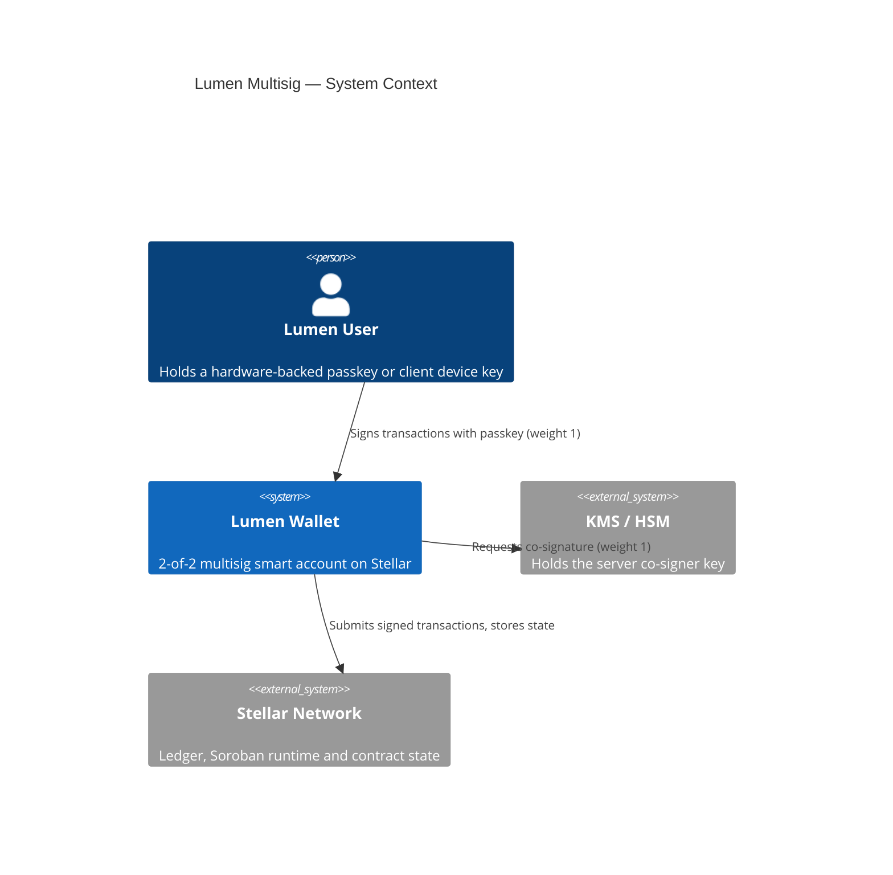
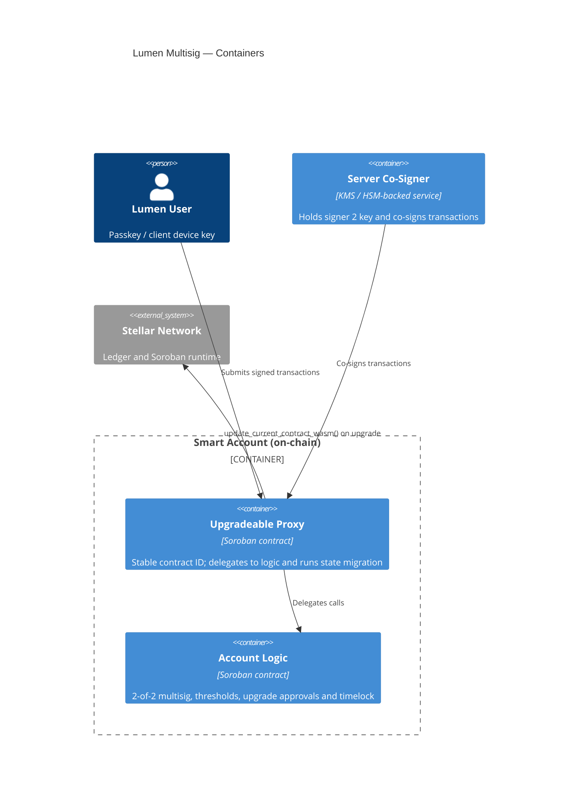
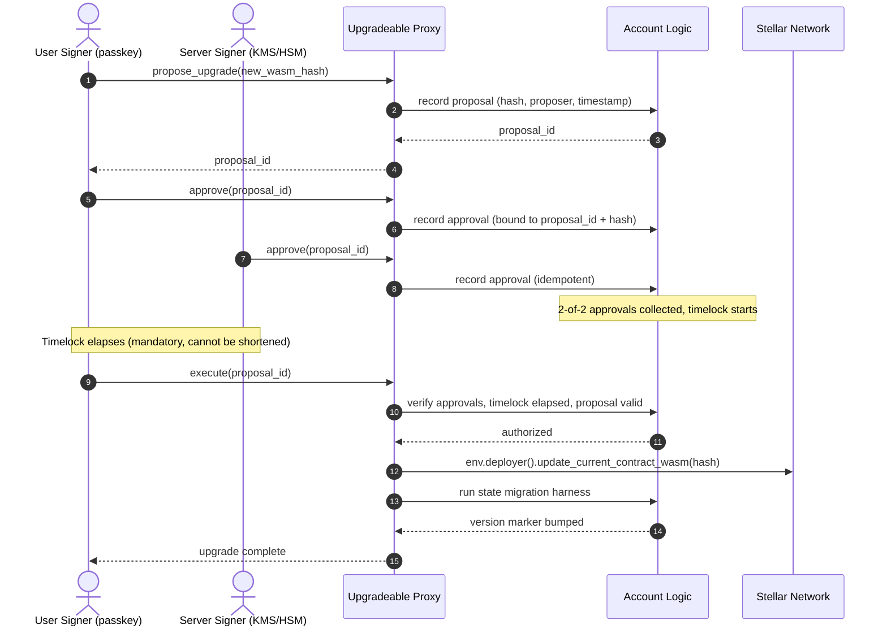

# 2-of-2 Multisig Architecture

Every Lumen user wallet is an on-chain 2-of-2 multisig account:

- **Signer 1 (User)**: Hardware-backed passkey or client device key (weight 1).
- **Signer 2 (Server)**: Co-signer key held securely in KMS or HSM (weight 1).
- **Thresholds**: Low: 1, Med: 2, High: 2.

Neither party can unilaterally drain funds.

## System Context

## Containers

## Upgradeable Proxy Pattern
=======

Smart accounts are deployed behind an upgradeable proxy so that future features can be added without changing the account address or losing existing state. The proxy contract upgrades its own logic using `env.deployer().update_current_contract_wasm()`, which swaps the executing Wasm while leaving the contract ID untouched.

Because the contract ID is preserved across upgrades:

- **Instance storage** (configuration, thresholds, signer metadata) is retained.
- **Persistent storage** (balances, nonces, replay-protection counters, recovery state) is retained.
- **The account address** remains stable, so external integrations and recovery flows keep working.

### State Migration Harness

Upgrades may introduce new storage layouts or change existing entries. The proxy includes a state migration harness that runs as part of the upgrade flow:

1. A version marker is stored in instance storage and checked on every entry point.
2. When the stored version is older than the contract's current version, the migration routine runs once and rewrites entries into the new layout.
3. The version marker is bumped only after migration completes successfully, so a failed migration can be retried safely.

This guarantees that account storage, nonces, and addresses survive logic updates.

## Multi-Sig Upgrade Approval

Upgrades are themselves sensitive operations and must be approved by the account's multisig. An upgrade cannot be executed by a single signer.

### Approval Flow

1. **Proposal**: A signer submits an upgrade proposal referencing the new Wasm hash. The proposal records the target hash, the proposing signer, and the time of submission.
2. **Approval**: Signers approve the proposal by signing it. Because the account is a 2-of-2 multisig, both the user signer and the server signer must approve before the proposal becomes executable.
3. **Timelock**: Once the required approvals are collected, a mandatory timelock begins. The upgrade cannot execute until the timelock has elapsed, giving both parties (and any monitoring tooling) a window to detect and veto an unexpected upgrade.
4. **Execution**: After the timelock expires, any signer may trigger execution. The proxy calls `env.deployer().update_current_contract_wasm()` with the approved hash, then runs the state migration harness.

### Timelock Guarantees

- The timelock is **mandatory**: there is no path that executes an upgrade before it elapses.
- The timelock duration is fixed by the contract and cannot be shortened by a single signer.
- A proposal that is not executed within its validity window expires and must be re-proposed and re-approved.

### Signer Approval Semantics

- Each approval is bound to the specific proposal (target Wasm hash and proposal ID) to prevent approval reuse.
- Approvals are recorded on-chain and are idempotent; a signer cannot double-count their approval.
- Either signer can veto a pending proposal, cancelling it before execution.
- Because both signers must approve, neither the user nor the server can unilaterally change the account logic — mirroring the fund-safety guarantee of the 2-of-2 threshold model.